# Polka

A gamepad-first file manager for Linux, written in Rust (egui).
Everything works from a controller: browsing, selection, file operations,
renaming via an on-screen keyboard. Keyboard and mouse work too.

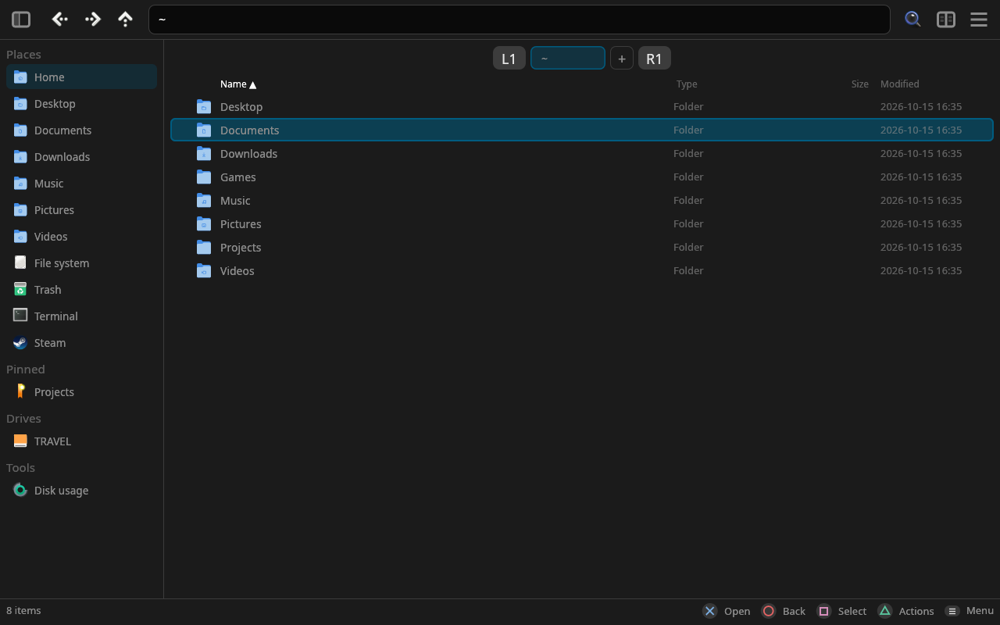

<table>
<tr><td width="50%">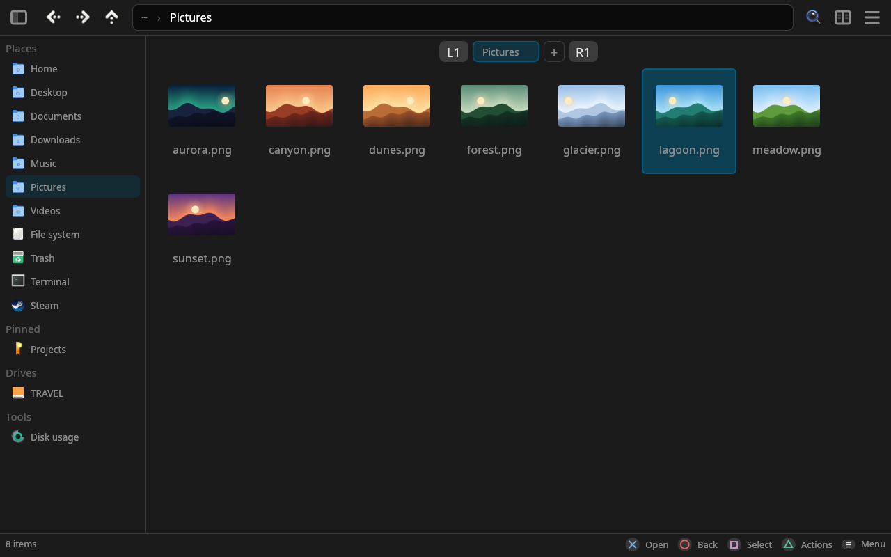<br><sub>Grid with thumbnails</sub></td><td width="50%">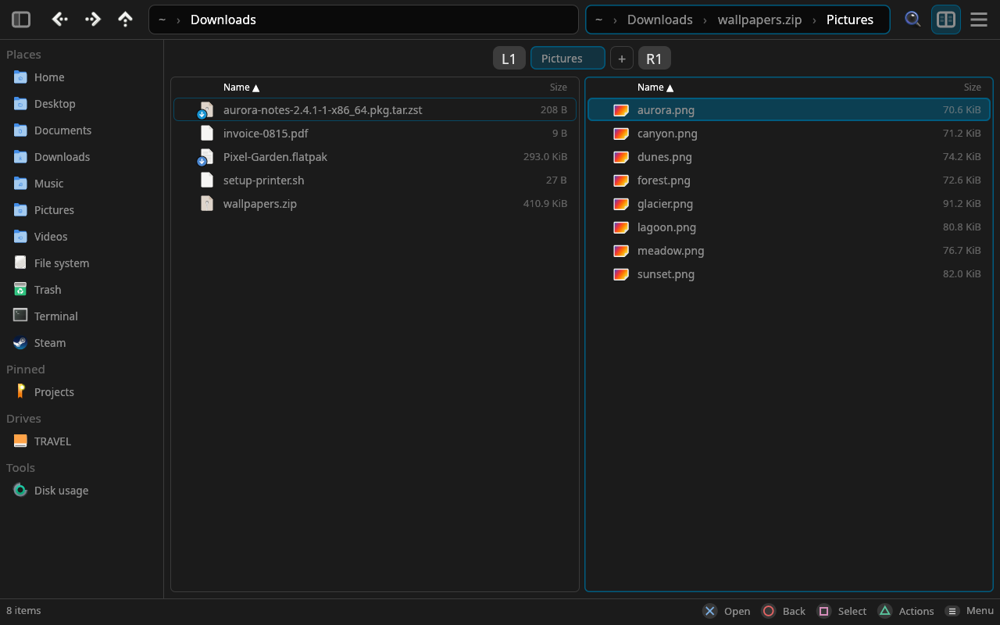<br><sub>Dual pane, inside a zip</sub></td></tr>
<tr><td width="50%">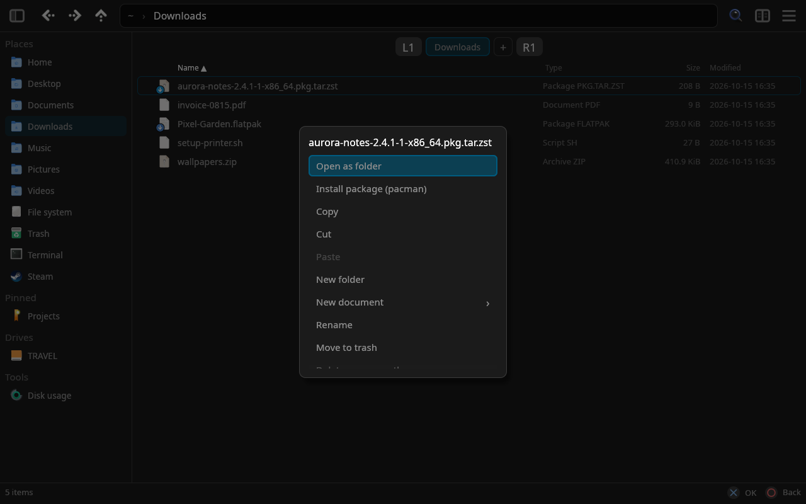<br><sub>△ actions on a package</sub></td><td width="50%">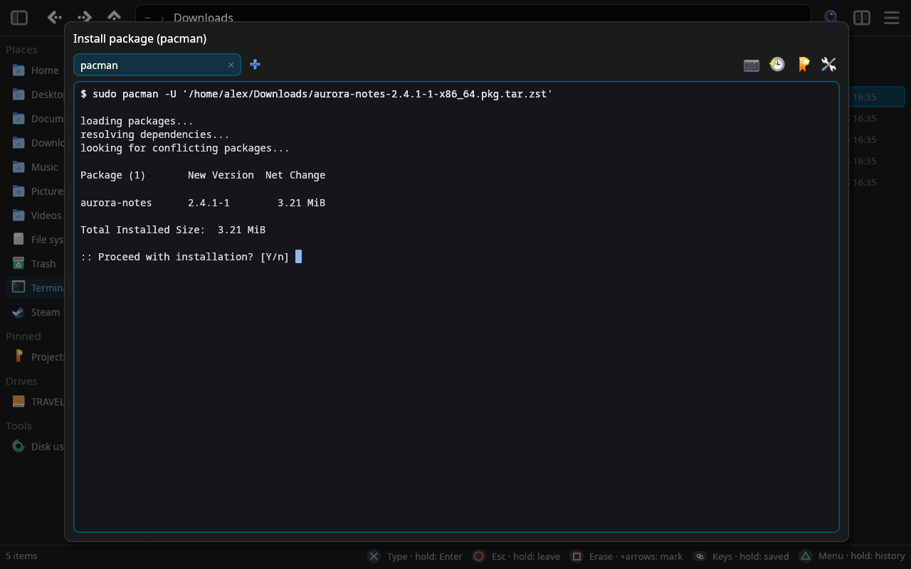<br><sub>Installing it with pacman, in a terminal window</sub></td></tr>
<tr><td width="50%">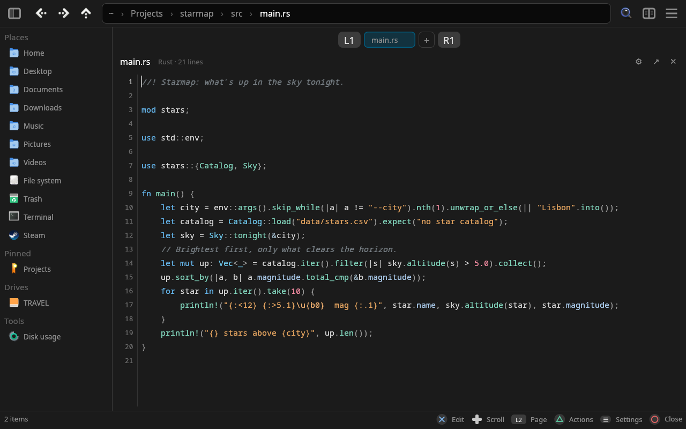<br><sub>Code viewer and editor</sub></td><td width="50%">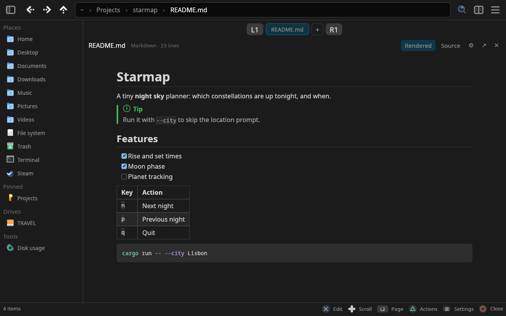<br><sub>Markdown, rendered</sub></td></tr>
<tr><td width="50%">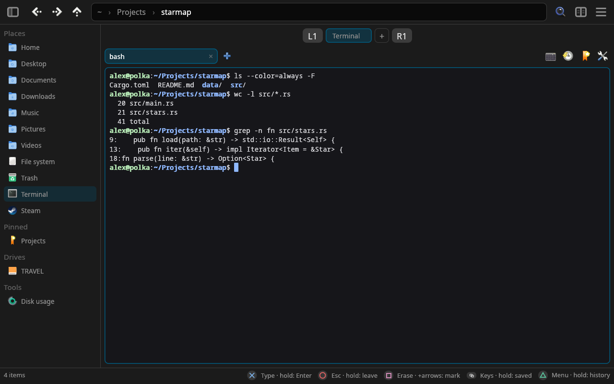<br><sub>Terminal page</sub></td><td width="50%">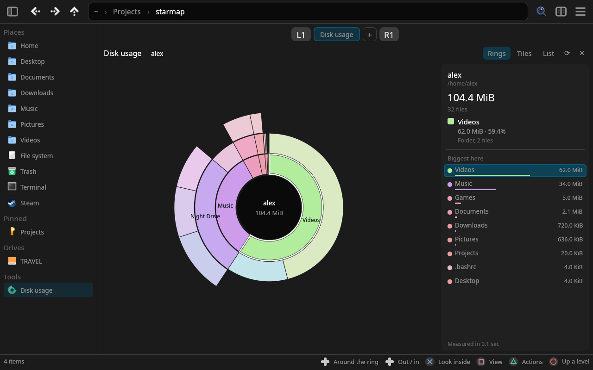<br><sub>Disk usage</sub></td></tr>
<tr><td width="50%">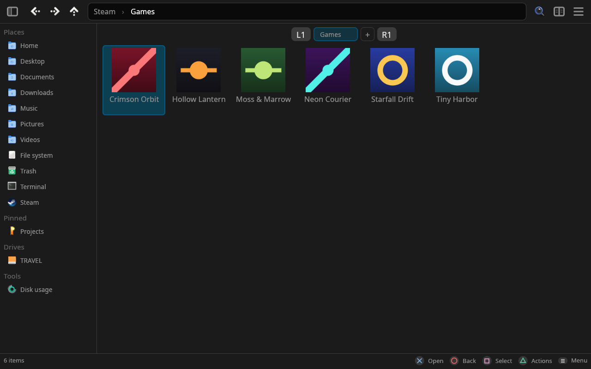<br><sub>Steam games by name, with their icons</sub></td><td width="50%">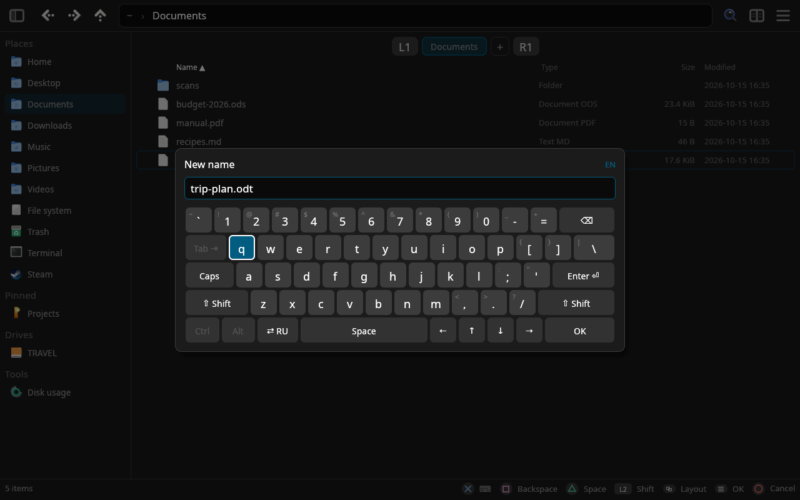<br><sub>On-screen keyboard</sub></td></tr>
<tr><td width="50%">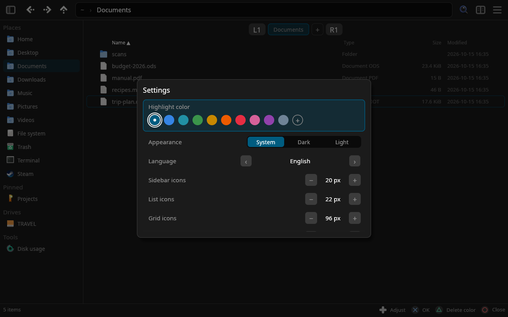<br><sub>Settings</sub></td><td width="50%">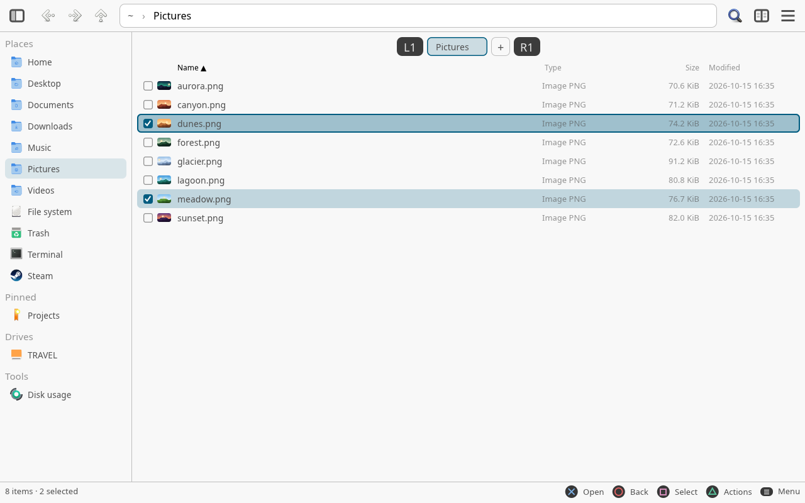<br><sub>Light look, check boxes</sub></td></tr>
</table>

<sub>Screenshots are rendered offscreen by a test (`demo_shots` in `src/view_tests.rs`) from a made-up home folder.</sub>

- Classic layout: collapsible sidebar (places, pinned folders, drives), path bar, tabs
- List and grid views, dual-pane mode: each side shows a tab of its own (marked L and R), and
  switching tabs moves only the active side; the right pane opens where it was (a setting)
- Archives work like folders (libarchive): browse zip, 7z, rar, tar.*, iso…; copy, move, rename,
  delete and create folders inside zip, 7z and tar.* (rar/iso are read-only)
- Built-in archiver: zip, tar.zst, tar.gz, tar.xz; smart extract
- Password-protected archives: zip (ZipCrypto/AES) via libarchive, 7z and rar via the `7z` tool;
  Polka asks for the password (hidden input) and retries. Passwords are kept in memory only
- Name clashes ask: keep both, replace (folders merge), skip
- Quick filter (live, as you type) and recursive search
- Settings (≡ → Settings…): highlight colour from presets or your own saved mixes, icon sizes for
  the sidebar, list and grid, interface scale, icon theme with live preview
- Top bar icons come from the icon theme (monochrome ones are recoloured to fit the UI)
- Image and video thumbnails, shared with other file managers via `~/.cache/thumbnails`
- Icons from the current icon theme, `.desktop` files and Windows `.exe`/`.dll` resources
- The on-screen keyboard is a real keyboard's main block with what Shift gives on every key (`!`
  on 1, `№` on 3 in Russian…), Caps Lock, a Paste key (the clipboard, on one line in a field), and for the terminal Ctrl, Alt, Tab and
  arrows; it fits small screens, and typing into a terminal leaves it most of the height. Layouts:
  EN, RU, UK, DE (QWERTZ), FR (AZERTY), ES with dead keys for accents, Korean (두벌식, jamo build
  syllables) and Japanese kana (JIS; ゛ ゜ voice the kana before, Caps writes katakana); which ones ⇄
  goes through is chosen in the settings. (Chinese would need a dictionary IME.)
- Pinned folders can use any theme icon (Papirus colour variants included) or your own picture
  (icon picker → △ "Own picture…", then pick an image in the panes); label sizes follow icon sizes

## Built-in viewer and player

Files open in the same window, in place of the panes (each kind can be sent to its desktop app
instead: Settings → "Open in Polka"):

- Text: tree-sitter highlighting for 30 languages, themes and fonts, editing from the pad or
  keyboard, search and replace by words or regular expressions (Ctrl+H; `$1` groups); Markdown rendered as on GitHub
  (pictures from the web too, through `curl`; a switch in the settings keeps it offline) or as source;
  paste from the pad reads the system clipboard
- Pictures: zoom, pan, EXIF rotation, browsing the folder; animated X cursors with their hotspot
- Music: mp3, flac, ogg, m4a/aac, alac, wav, aiff and more (Symphonia); Opus, WMA, APE and other
  formats through `ffmpeg` if installed. Tags and cover art (embedded or `cover.jpg` next to the
  tracks), the folder as a playlist, repeat, volume. Music keeps playing in a background tab.

| Player | Gamepad | Keyboard |
|---|---|---|
| Play / pause | ✕ / A | Space, K |
| Seek 5 s (30 s) | ← → (□ held) | ← → (Shift) |
| Previous / next track | L2 / R2 | PgUp / PgDn, P / N |
| Playlist | ↑ ↓, then ✕ / A | ↑ ↓, Enter |
| Repeat: off / all / one | □ / X tap | R |
| Volume | □ / X held + ↑ ↓ | + / − |

- Video (needs `ffmpeg`): mp4, mkv, webm, avi, mov and the rest of what ffmpeg reads; sound in
  sync, audio track choice, subtitles (text ones inside the file, or `.srt`/`.ass`/`.vtt` next
  to it), full screen, the folder's videos one after another. Pauses when its tab is left.

| Video | Gamepad | Keyboard |
|---|---|---|
| Play / pause | ✕ / A, click | Space, K |
| Seek 10 s (60 s) | ← → (□ held) | ← → (Shift) |
| Volume | ↑ ↓ | ↑ ↓, + / − |
| Previous / next video | L2 / R2 | PgUp / PgDn, P / N |
| Full screen | Create / View, double click | F, F11 |
| Subtitles / audio track | □ / X tap / △ menu | S / A |

## Administrator rights, packages, scripts

Saving a system config, or copying, moving, renaming, deleting, linking or making files where only
root may: Polka asks for the sudo password (on-screen keyboard; shown as asterisks or fully
hidden, see Settings) and does it with sudo — `cp` keeps the file's owner and mode. A password
that worked is reused for ten minutes, in memory only. Files out of system folders are deleted
rather than trashed.

Package files are checked by what's inside (.PKGINFO, debian-binary, the rpm lead, squashfs…)
and marked with their format on the icon; a fake named like one stays a plain archive. With
"Install packages on open" (on by default) ✕ installs them; △ still opens them as folders.
△ on a package offers installing it with the system's own tool, when there is one: pacman
(`.pkg.tar.*`), flatpak (`.flatpak`, `.flatpakref`), apt / dpkg (`.deb`),
dnf / zypper / rpm (`.rpm`), snap (`.snap`); on a shell script, running it. It runs in a terminal
window that shows the command and takes the tool's questions and sudo's password; it closes when
done, and waits for Enter if something failed. Dropped items can also be linked ("Create link
here").

## Terminal

Sidebar → Terminal (or △ on a folder → "Open in terminal", ≡ → "Open terminal here") opens
shells in their own tabs inside the page. Built on alacritty's terminal core: colours, full-screen
programs (htop, btop, mc, vim, less…), mouse, scrollback; box drawing, blocks and braille are drawn
to the cell so tables and graphs join up. Settings: colour scheme, font, size, shell, cursor,
scrollback, start folder.

| Terminal | Gamepad | Keyboard |
|---|---|---|
| Arrows | D-pad | as usual |
| Type: the on-screen keyboard, straight into the shell (keys as pressed, Ctrl / Alt / Tab / arrows included; the terminal makes room for it) | ✕ / A tap | type |
| Enter | ✕ / A held | Enter |
| Erase a character | □ / X tap | Backspace |
| Mark part of the command, then erase it | □ / X held + ← → (↑ ↓: to the line's start / end), then □ / X tap | — |
| Esc | ○ / B tap | Esc (on release) |
| Leave for the sidebar (shells keep running) | ○ / B held | Esc held |
| Menu: type a command, interrupt, copy, paste, launch htop/btop/… | △ / Y tap | Ctrl+C, Ctrl+Shift+C / V |
| Command history | △ / Y held | Ctrl+Shift+H |
| Quick keys for what's running (vim, nano, htop, mc, less, lazygit, tmux…) | Create / View tap | Ctrl+Shift+K |
| Saved commands | Create / View held | — |
| Scroll back / page | L2 / R2 | Shift+PgUp / PgDn |
| Choose text to copy | △ → "Choose text to copy": move, □ start, ✕ copy | drag, Ctrl+Shift+Space |
| Terminal tabs | tab strip, △ → Terminal tabs | Ctrl+Shift+T / W, Ctrl+PgUp / PgDn |

History and saved commands are put in, not run: ✕ held runs them. History merges the shell's own (fish, zsh, bash) with what was run from here. In the Flatpak the
shell runs on the host (`flatpak-spawn` and `script`), with resizes, Ctrl+C and the current folder.

## Steam

Sidebar → Steam: **Games** lists the installed games of every library (folders without a manifest
are named from Steam's app cache), **Prefixes** lists the Proton prefixes (`compatdata/<id>`) under
their games' names — non-Steam shortcuts and uninstalled games included. **Screenshots** lists the
games with screenshots, each opening its real folder (`userdata/<id>/760/remote/<appid>/screenshots`);
**Recordings** lists the games with Steam game recordings, then each one's (background recordings
and clips, by date, newest first), played in Polka's video player (they're DASH videos: a
`session.mpd` and its chunks); △ → Convert… makes ordinary videos of them in Videos/Steam, named
after the game and time (MP4 and MOV as they are, quick and lossless). Going up from a game's folder or prefix comes back to the list.

△ → "Add to Steam" on a Windows program (`.exe`, `.bat`, `.msi`) or a `.desktop` launcher puts it in
the library as a non-Steam game, with its icon (the exe's own, or the launcher's theme icon) and,
for Windows programs, Proton Experimental (unless Steam Play is on for every title). Steam keeps the
list in memory while it runs: Polka offers to restart it, or the game shows after its next start
(in the Deck's game mode only the latter). Without a Steam install none of this shows. Games and prefixes wear the icon of the game's own `.exe`
(sharper than Steam's), else Steam's.

## Disk usage

**Tools → Disk usage** in the sidebar (or △ on a folder) measures home, the current folder or a
whole disk in the background (space on disk; hard links counted once; other file systems mounted
inside are skipped) and shows it as **rings** like Filelight, **tiles** (a treemap) or a **list**.
The result stays in its tab while you browse and can be measured again in place.

| Disk usage | Gamepad | Mouse |
|---|---|---|
| Around the ring / neighbours | ← → | hover for details |
| Out / in a ring | ↓ ↑ | |
| Into a folder / show a file in the panel | ✕ / A, R2 | click |
| Up a level | ○ / B, L2 | click the middle, the path |
| Rings → tiles → list | □ / X | the buttons in the header |
| Open in the panel, new tab, measure again | △ / Y | right click |

## Controls

| Gamepad (PlayStation / Xbox) | Action | Keyboard |
|---|---|---|
| D-pad / left stick | Move | Arrows |
| ✕ / A | Open folder, run file | Enter |
| ○ / B | Back (clears selection first) | Backspace, Esc |
| □ / X | Select; hold and move for a range (moving back shrinks it; arrows stay in the pane) | Space, Insert, Shift+arrows |
| △ / Y | Actions menu | Shift+F10 |
| Options / Menu | App menu | F10 |
| Create / View | Toggle dual pane | F3 |
| L1 / R1 | Previous / next tab | Ctrl+← →, Ctrl+Tab, Ctrl+PgUp/PgDn |
| L2 / R2 | Left / right pane (dual), page up / down (single) | Tab, PgUp/PgDn |
| L3 | Collapse sidebar | Ctrl+B |
| — | History back / forward | Alt+← → |

The usual keys of other file managers work too: Ctrl+C / X / V copy, cut and paste files, Ctrl+A
selects all, F2 renames, Delete moves to the trash (Shift+Delete deletes for good), Ctrl+Shift+N
makes a folder, Ctrl+T / Ctrl+W open and close tabs (Ctrl+Shift+T brings the last closed one back),
Ctrl+L goes to a path, Ctrl+H shows hidden files, F5 / Ctrl+R refresh, Alt+Home goes home,
Alt+Enter shows properties, Ctrl+D pins the folder, Ctrl+1 / Ctrl+2 switch grid / list, F4 opens a
terminal here, F9 hides the sidebar. F1 lists them.

**Open with…** (△ on any file): the programs that take its type, the usual one first, or all of
them; "Always open this type with it" makes the choice the system's default for the type
(`xdg-mime`, so other programs follow it too).

The right stick and the touchpad are intentionally left unbound.
Menus: → or ✕/A opens a submenu (View, Sorting), ← or ○/B goes back; toggles keep the menu open.

Filter: app menu → Filter… or Ctrl+F (○/B clears it). Search in subfolders: app menu or Ctrl+Shift+F.

On-screen keyboard: ✕/A types the key, □/X erases, △/Y inserts a space, L1/R1 move
the caret, L2 toggles shift, Create/View switches layout (EN/RU), Options/Menu confirms.

Gamepad input is ignored while Polka is not the focused window. Touch screens, touchpads and pens
aren't taken for pads (on the Steam Deck the screen's touches stay touches).

**Touch screen.** Two quick taps open (Settings → Open by touch: or one); a single tap points at
an item. Used by a finger, the list shows every item's check box, big enough to hit; a tap on it
takes the item in or out of the selection; a tap on empty space clears the choice, and held a moment there then moved it draws a
selection rectangle. A
finger moved up or down scrolls, gliding on after a flick; held still half a second (a ring fills
under the finger) and let go it's a right click — the menu — and moved on it picks up what's under
it to drag; a quick swipe sideways goes back or forward, from the left edge it shows the sidebar;
two fingers apart or together make the icons bigger or smaller (in a picture they zoom it).

**Mouse.** The list's headers (Name, Type, Size, Modified) sort by their column, a second click the
other way; check boxes (on the selected, under the pointer, and all while anything is selected)
take items in and out of the selection. The grid spreads its icons over the whole width. Click selects (Ctrl toggles, Shift selects a range), double click opens, middle
click opens a folder in a new tab, the side buttons go back / forward. Drag from empty space
(right of the names in the list, between icons in the grid) for a selection rectangle; Ctrl
adds to the selection. Drag items by their icon or name onto a folder, the other pane or a
sidebar place, then pick Move here / Copy here (the usual one is preselected: a move on the
same disk, else a copy; Ctrl or Shift held skips the question). Dropped on a program, script or
launcher they can also be opened with it. Onto the trash they're trashed. A drag resting a moment on
a folder or archive in the list, a folder of the address bar's path, a sidebar place or a tab opens
it (a line fills up meanwhile), so the target can be reached without letting go. In dual mode an address bar held a
moment (at once while dragging) widens to show the whole path. Files dragged in from other programs land
the same way, and items pulled out of the window go to other programs (Wayland; X11 takes drops
into the panel). A folded multi-volume
set is selected whole; an unfolded one volume by volume. The status bar shows, past the item count, the disk's space used / free (after a bar of how full it is)
and how many folders, pictures, videos and archives the folder holds, an icon and a number each
(hover one for what it is; View → Status bar picks which). In a narrow window they give way to
the button hints, the last ones first. Running operations show a progress card
(item, amount, speed, time left, cancel; also App menu → Cancel operations). Folders on screen follow
changes made by other programs (looked at every couple of seconds): what's added or removed shows
up, the cursor and selection stay put.

**Window.** Settings → System title bar off: Polka's top bar is the title bar. It gets the window's
minimize / maximize / close buttons. Settings → Window buttons picks their look, each previewed: as
the desktop's own (Breeze on KDE, Adwaita's round buttons on GNOME, else the icon theme's), Breeze,
Adwaita, Ubuntu (an orange close), macOS traffic lights, Windows 11, the icon theme's or simple lines;
also which side they sit on and their order; drag the address bar (or the room around it) to move
the window, double click it to maximize; the window's edges resize it.

**Sidebar.** Its edge pulled to the left folds it to icons, pulled back out unfolds it (a click
or tap on the edge flips it). ✕ (or a click) opens a place and the sidebar keeps the focus; → or ○ goes over to
it. Places, pinned folders, **drives** (every partition that isn't the system's, mounted
or not: ✕ mounts and opens one, △ has Mount / Unmount / Eject through udisks, which asks polkit for
a password when needed) and tools. △ on any entry chooses its icon (a theme icon or your own
picture); on the trash it also empties it (after asking). The trash looks empty, half full (a few
items) or full, when the icon theme draws all three (`gnome-stock-trash-empty`, `gnome-stock-trash`,
`gnome-stock-trash-full`); else empty or full. In the trash, △ → Restore puts items back where they
were (their folder made again if it's gone); if something is there now it asks: keep both, replace
or skip.

**Languages.** English, Русский, Українська, Deutsch, Español, Français, Polski, Қазақша,
Oʻzbekcha, हिन्दी, 中文, 日本語, 한국어 —
the system's by default (`LANGUAGE`, `LC_ALL`, `LC_MESSAGES`, `LANG`), English when it isn't one
of these; Settings → Language switches on the fly. CJK text needs a CJK font (e.g. noto-fonts-cjk),
Hindi a Devanagari one (e.g. noto-fonts). The on-screen keyboard has layouts for each of them
(Polish with ą ę ł ó ś ż on keys and ´ for ć ń ś ź; Kazakh as the KZ layout; Uzbek Latin with ʻ;
Hindi InScript).

**Tags.** △ → Tags… on any files and folders: tick the tags they share, or type a new one. They
are kept in the `user.xdg.tags` attribute, the same place KDE's Dolphin keeps them, so both see
the same tags (on filesystems without such attributes Polka keeps its own list). A folder with
tagged items gets a Tags column in the list; the grid shows a dot per tag. Search and the quick
filter take `#tag` words: `#work report` finds items tagged *work* with *report* in the name;
□ (or 🔍) on a tag in the Tags dialog looks for it from the current folder down.

**Converting.** △ → Convert… on any files: they're sorted into pictures, sound, video,
archives and tables; each kind shows its files (thumbnails), then the format they become — archives with the
archive dialog's own settings (format, method, level, split, password) — and what can't be
converted is listed last with why. Each kind gets a format of its own — a mix of PNG, JPEG and WebP all become PNG (the
ones already PNG stay as they are), while the songs picked along with them become MP3. Pictures:
PNG, JPEG, WebP, AVIF, HEIC, BMP, TIFF, GIF, from those and iPhone's HEIC, AVIF and JPEG XL. Sound:
MP3, AAC, Opus, Vorbis, FLAC, WAV. Video: MP4 / MOV (H.264, plays anywhere — iPhone's HDR HEVC
too), MKV (only the container changes, nothing re-encoded), WebM (VP9), or just its sound. Archives
are repacked as zip, 7z or a tarball; a multi-volume set becomes one archive; password-protected
ones are left out. Quality: high, balanced or small; the originals can go to the trash after. The
results go beside the originals. Plain pictures and archives need nothing else; ImageMagick does
pictures best (HEIC, AVIF, the camera's rotation), libheif's `heif-dec` / `heif-enc` and `avifenc`
fill in without it; sound and video need ffmpeg. HEIC, AVIF and JPEG XL also open in the viewer and
get thumbnails.

**Tables.** CSV (any separator: found by itself, or chosen — a preview shows how the first CSV reads
with it; UTF-8, UTF-16 or Windows-1251), TSV and spreadsheets (xlsx, xlsm, xls, xlsb, ods) convert to
CSV (with a separator of your choice), XLSX, ODS, TSV, JSON (objects by the header's names),
Markdown or HTML; plain numbers become numbers in a spreadsheet ("007" stays text), a workbook's
sheets stay sheets (or become a file each). A simple table — a header row, then data — can be cut
every 100 … 1 000 000 rows, the header on each part (`name 1.csv`, `name 2.csv`…), and several
with the same columns (case aside, any order) glued into one (`name (merged).csv`), cut too if
asked. Nothing extra is needed; xls is read only.

**Phones.** An Android phone (with USB set to *File transfer*) or an iPhone / iPad plugged in
shows up in the sidebar's Phones section, faded until it's opened; ✕ mounts and opens it, △ →
Disconnect unmounts it before unplugging. Polka uses what the system has: for Android
`aft-mtp-mount` (android-file-transfer), GVfs (gvfs-mtp), jmtpfs or simple-mtpfs; for iPhone `ifuse`
(with usbmuxd) or GVfs (gvfs-afc) — an iPhone asks *Trust this computer?* the first time: unlock
it, tap Trust and open it again. A phone that's only charging says to switch its USB mode.
`polka --diagnose` lists the phones it sees and what it would mount them with.

**Network places.** ≡ → Add network place…: SMB, NFS, SFTP, WebDAV, FTP or an rclone remote
(Google Drive, OneDrive, S3… whatever `rclone config` has). They sit in the sidebar's Network
section, faded until connected; ✕ connects and opens one, △ connects, disconnects, edits or
removes it. Polka mounts them with what the system has, so they're plain folders everywhere else:

| | tried in this order |
|---|---|
| SMB | GVfs (`gvfs-smb`), rclone, `mount.cifs` (sudo) |
| NFS | `mount.nfs` (sudo) |
| SFTP | sshfs, rclone, GVfs |
| WebDAV, FTP | rclone, GVfs |
| rclone | rclone |

(a different one can be picked in the dialog; what's missing says what to install). SFTP tries
your SSH keys first and asks for a password only if they're refused. Passwords go to the keyring
(`secret-tool`) when it's there and asked for, else they're kept until Polka closes — never in the
settings file. sudo mounts take the password for SMB from a file only you can read, removed right
after.

**Look.** Settings → Appearance: as the desktop (xdg-desktop-portal's colour scheme, followed
live), dark or light. Icon themes with light/dark siblings (Papirus, Breeze) switch along. Themes
whose folders come in colours (Papirus) offer them in the icon theme picker: on the pad → goes
over to the colours (○ back to the themes, ✕ applies); with the mouse a click picks and OK applies.
Nothing changes before that, the preview shows the pick. Folders, home and desktop take the colour
in Polka only; the theme itself is left as it is.

**Colour schemes.** Settings → Color scheme (‹ ›, or ← → on the pad): Standard (dark or light, as
set above), the classics — Nord, Dracula, Gruvbox Dark / Light, Solarized Dark / Light, Catppuccin
Mocha / Latte, Tokyo Night, One Dark, Monokai, Rosé Pine — and some for the holidays: New Year,
Christmas, Lunar New Year, Valentine's Day, St. Patrick's Day, Easter, Halloween. A scheme brings its
own highlight unless you picked one. Your own go in `~/.config/polka/schemes/` as JSON files (the
folder button on that row, or △, opens it, with an example to rename):

```json
{
  "name": "My scheme",
  "dark": true,
  "background": "#1e1e2e",
  "surface": "#313244",
  "field": "#181825",
  "text": "#cdd6f4",
  "border": "#45475a",
  "accent": "#cba6f7"
}
```

`background`, `surface` (buttons) and `text` are needed; `field` (text fields), `border`, `accent`
and `dark` follow from them when left out. In the Flatpak the folder is
`~/.var/app/io.github.sendement.Polka/config/polka/schemes/`. Files are read again each time the
settings open.

## Install

From the [releases](https://github.com/sendement/polka/releases):

- Arch Linux and derivatives: `sudo pacman -U polka-<version>-1-x86_64.pkg.tar.zst`, or build the
  attached `PKGBUILD` with `makepkg -si`
- Anywhere with Flatpak, Steam Deck included, from Polka's own repository (updates come with
  `flatpak update` or Discover as releases come out; the runtime comes from Flathub):

  ```sh
  flatpak install --user https://sendement.github.io/polka/polka.flatpakref
  ```

  or a release's `polka-<version>-x86_64.flatpak` bundle (no updates):
  `flatpak install --user polka-<version>-x86_64.flatpak`. The repository is signed with
  [this key](packaging/flatpak/repo-key.asc) (`8BE1 1114 515B 69AE 8141 26C1 6244 0DA1 D1F1 20BB`).

## "Show in folder"

Browsers, chat programs and download lists ask the desktop's file manager to show a file through
D-Bus (`org.freedesktop.FileManager1`). A running Polka answers: the folder opens in a tab with the
file under the cursor (several files are selected), and the window is raised where the compositor
allows. With no Polka running, the Arch package's D-Bus service starts one (`polka --dbus`).

Another file manager that already holds the name keeps it; Polka waits in line and takes over when
it quits. With Dolphin installed, stop its background copy and let Polka's service file win:

```sh
mkdir -p ~/.local/share/dbus-1/services
cp /usr/share/dbus-1/services/io.github.sendement.Polka.FileManager1.service ~/.local/share/dbus-1/services/
systemctl --user stop plasma-dolphin.service
busctl --user call org.freedesktop.DBus /org/freedesktop/DBus org.freedesktop.DBus ReloadConfig
```

## Build

Needs Rust, libarchive and zstd (`pacman -S libarchive zstd`).

```sh
cargo build --release
./target/release/polka [DIR | FILE | ARCHIVE | file://URI]
```

Arch package: `makepkg -si` in `packaging/arch` builds the tagged release (the binary, desktop
entry and icon).
Video playback and thumbnails need `ffmpeg` (or `ffmpegthumbnailer` for thumbnails); so does
music in formats Symphonia can't decode.

Settings live in `~/.config/polka/config.toml` (pinned folders, view, sort,
`icon_theme` override, `zoom` for TV use; Ctrl+= / Ctrl+- also zoom).
In Steam's game mode (gamescope) the interface is sized as for a screen 800 points tall, whatever
scale X11 reports there, and its zoom (`zoom_game`) is kept apart from the desktop's.
`POLKA_NO_GAMEPAD=1` disables controller input.

## Flatpak

`packaging/flatpak/` builds the same program as a Flatpak (`io.github.sendement.Polka`, on
org.freedesktop.Platform 25.08 with 7-Zip built in). Inside the sandbox Polka uses your real
folders (trash, shared thumbnails, settings), the host's icon themes, starts the programs you open
on the host, and talks to UDisks2 for drives.

```sh
flatpak install flathub org.freedesktop.Sdk//25.08 org.freedesktop.Sdk.Extension.rust-stable//25.08
flatpak-builder --user --install --force-clean build-dir packaging/flatpak/io.github.sendement.Polka.yml
flatpak run io.github.sendement.Polka
```

`polka --diagnose` (or `flatpak run io.github.sendement.Polka --diagnose`) prints what Polka sees
around it — folders, icon themes, trash, disks, gamepads, whether it can start host programs — handy
for bug reports.

After changing dependencies, regenerate `packaging/flatpak/cargo-sources.json` with
[flatpak-cargo-generator](https://github.com/flatpak/flatpak-builder-tools/tree/master/cargo).

## Tests

```sh
cargo test
# offscreen UI renders (needs a GPU):
POLKA_TEST_DIR=/some/dir POLKA_SHOT_DIR=/tmp/shots cargo test -- --ignored screens
```

The README's screenshots come from `demo_shots`, which builds a made-up home folder; see its
comment for running it in `bwrap` so that paths read `/home/alex`.

`tools/fakepad.py` creates a virtual Xbox pad via uinput for manual input testing
(`examples/padtest.rs` prints what Polka receives).

## License

MIT. Audio decoding uses [Symphonia](https://github.com/pdeljanov/Symphonia) (MPL-2.0).
`vendor/egui-winit` is [egui-winit](https://github.com/emilk/egui) (MIT OR Apache-2.0) with one
change: on Wayland the clipboard goes through Polka's own data device, which also does drag and
drop with other programs (see `vendor/egui-winit/POLKA-NOTICE.md`).
